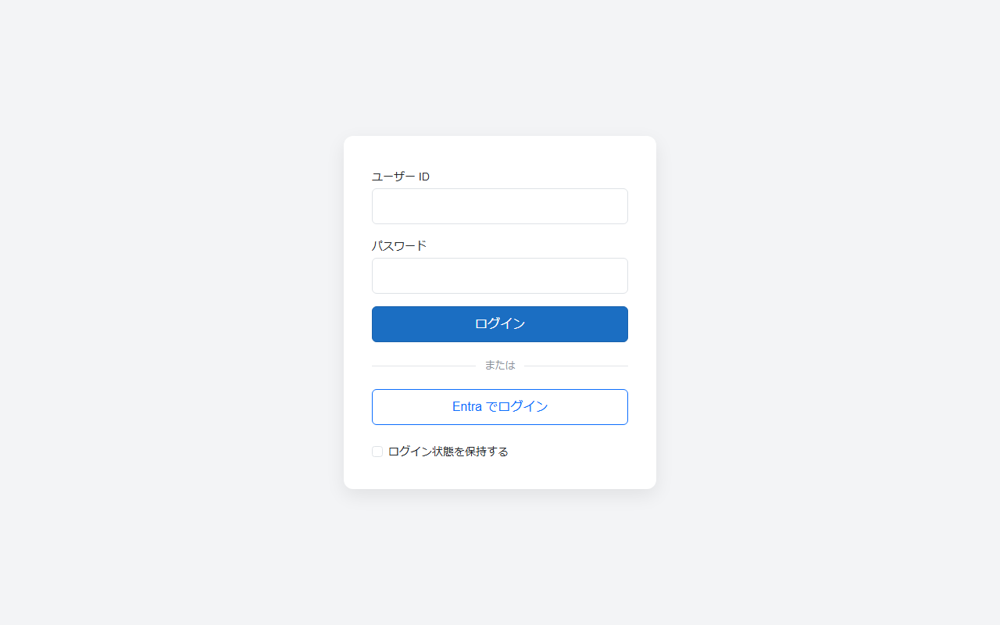
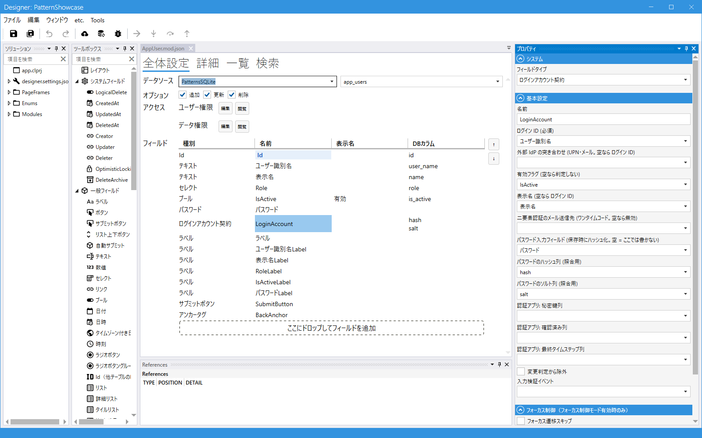

# 認証 (ログイン) の全体像

Codeer.LowCode.Blazor 本体が持つのは**認可** (ログインしたユーザーに何を見せ、何を書かせるか) だけで、
**認証** (誰がログインしたかの確認) はライブラリに含まれません。認証はホストアプリ (Visual Studio テンプレートで作る Server プロジェクト) の担当で、
その実装をこの Extras が **MIT ライセンス**で提供します。動作を変えたい場合はソースをコピーして改変できます。

| 役割 | 担当 | 場所 |
|---|---|---|
| 認可 (CurrentUser・モジュール / 行 / PageFrame の条件・権限フィールド) | Codeer.LowCode.Blazor 本体 | 製品 ([マニュアル: 認証 / 認可の概要](https://github.com/Codeer-Software/Codeer.LowCode.Blazor.Manual/blob/main/JP/authorization/authorization.md)) |
| ログインアカウントの宣言 (ユーザーモジュールの契約フィールド) | Codeer.LowCode.Blazor.Extras | このリポジトリ (MIT) |
| ID/パスワード照合・パスワードのハッシュ化・外部 IdP・二要素認証 | Codeer.LowCode.Blazor.Extras.Server | このリポジトリ (MIT) |
| ログイン画面・Cookie の発行・エンドポイント (`api/account/*`) | ホストアプリ | [Starter リポジトリ](https://github.com/Codeer-Software/Codeer.LowCode.Blazor.Starter) の Cookie ホスト (テンプレートに同梱) |

ホストと本体の境界は「ログイン中ユーザーの id を渡す」の 1 点だけです。ホストは認証が済んだユーザーの id (ユーザーモジュールの `Id`) を Cookie に載せ、
本体はそれを `app.clprj` の Current User Module の行に結びつけて `CurrentUser` と認可に使います。
どの方式でログインしても (パスワード / Entra ID / Google / 二要素認証) 認可の設定は変わりません。

ログイン画面はテンプレートの `login.html` が固定の枠を持ち、外部 IdP を設定するとボタンが増えます (パスワード入力の下)。



## 部品

### ユーザーモジュールの契約: LoginAccountContractField

ログインユーザーモジュール (`app.clprj` の Current User Module) に 1 つ置き、「この行がログインアカウントとしてどう振る舞うか」を宣言するフィールドです。
サーバーのログイン処理はこの契約だけを見るので、フィールド名や列名は自由に決められます。

| 宣言 | 内容 |
|---|---|
| LoginName (必須) | ログイン ID を持つフィールド (ユーザー名・メールなど) |
| ExternalLoginName | 外部 IdP が確認した本人 (UPN / メール) と突き合わせるフィールド。空なら LoginName |
| IsActive | 有効フラグ。偽ならログイン拒否 (退職・停止) |
| DisplayName | 画面のユーザー表示と認証アプリの QR に使う名前 |
| TwoFactorEmail | メールのワンタイムコードによる二要素認証の送信先 |
| PasswordField | パスワードの入力フィールド (PasswordField)。指定すると保存時にサーバーがハッシュ / ソルトを作って下の列に書く |
| DbColumnPasswordHash / DbColumnPasswordSalt | パスワード照合用の列 (書き込み専用)。両方空なら外部 IdP 専用 |
| DbColumnTotpSecret / DbColumnTotpConfirmed / DbColumnTotpLastTimestep | 認証アプリ (TOTP) の 3 列。そろえて設定すると有効 |

→ 詳細: [LoginAccountContractField](../Source/Codeer.LowCode.Blazor.Extras.Designer/FieldDocs/LoginAccountContractFieldDesign.md)

デザイナのテンプレート (空のプロジェクト / 標準パターン集 / 業務テンプレート) の `AppUser` には配置済みです。



### パスワードの保存

契約の `PasswordField` を指定すると、ユーザーを保存するときにサーバー (`PasswordHashHelper.ApplyPasswordHash`、テンプレートの `CustomizedModuleDataIO` が呼ぶ) が
平文からハッシュ / ソルト (PBKDF2-HMAC-SHA256) を作って契約の列に書きます。ユーザーモジュールに別のフィールドは要りません。
契約の無いモジュール (同じテーブルを参照するパスワード変更ダイアログなど) では [PasswordHashField](PasswordHashField.md) を使います。

### ID/パスワードのログイン: LoginAccountStore

`Codeer.LowCode.Blazor.Extras.Server.Auth.LoginAccountStore` がデザインの契約からテーブル・列を引き、ログイン ID で行を探してハッシュを照合します。
有効フラグが偽の行は拒否します。初回起動でユーザーが 0 件なら `admin` / `admin` を作ります。

### 総当たり対策: LoginLockout

`Codeer.LowCode.Blazor.Extras.Server.Auth.LoginLockout` がアカウントごとにログインの失敗 (パスワード・二要素認証のコードの不一致) を数え、
続けて `MaxFailedAttempts` 回 (既定 10) に達したら、最後の失敗から `LockoutMinutes` 分 (既定 5) そのアカウントのログインを受け付けません (正しいパスワードでも)。
ロックが繰り返されるたびに長さは倍になり (5 分 → 10 分 → 20 分 …)、上限は `MaxLockoutMinutes` (既定 1440 = 1 日) です。サインインできたら全部数え直します。
二要素認証のコードを求めた段階、メールのコードの期限切れ (`code_expired`)、照合中の例外 (DB の障害など) は失敗に数えません。既定では、1 つのアカウントに試せるのは最初の 24 時間で 90 回、以降は 1 日 10 回ほどです (1 インスタンスのとき。記録は最後の試行から 30 日残るので、黙って待っても段階は戻りません)。

- 鍵はアカウントの Id です (`LoginAccountStore.FindByLoginNameAsync` で引く)。DB の照合順序で同じ行に当たる別表記 (大文字小文字・全角半角など) も 1 つに数えます
- 存在しないログイン名は数えません (ASP.NET Identity と同じ)。アカウントの有無を隠すことはこの機能の目的ではありません
- ロック中の `api/account/login` は 429 を返し、ログイン画面は「しばらくしてからやり直してください」を出します
- 照合の前に 1 回分を数えるので、同時に大量に送られても回数を超えて照合しません (1 つのプロセスの中での保証)
- 回数はサーバー側のキャッシュ (`IDistributedCache`) に置くので DB 列は要りません。記録は最後の試行から 30 日で消えます。キャッシュが使えないとき (共有キャッシュの障害など) は、ロックを判定できないのでパスワードのログインはエラーになります
- 複数インスタンスなら共有キャッシュ (Redis 等) にします。読んで書くまでの排他はインスタンスの中だけなので、インスタンスをまたいで同時に送られたときの回数は保証しません (数え漏らしが起きる)。厳密に抑えたいときは前段の IP 単位の制限と併用します。共有キャッシュを複数のアプリ (本番と検証など) で使うときは、`InstanceName` でアプリごとに分けます (鍵はアカウントの Id なので、分けないと別のアプリの同じ Id と回数を共有します。メールのワンタイムコードも同じキャッシュに置きます。こちらは送信先が違うコードを通さないので取り違えは起きませんが、発行したコードが上書きされて再送が要ることがあります)
- ロックは時間が経つまで解けません (管理者がパスワードを設定し直しても解けない)。急いで解くときは、キャッシュのキー `codeer.loginlockout.<アカウントの Id>` を消すか、既定のメモリキャッシュならサーバーを再起動します
- ログイン ID を知っていれば、他人がそのアカウントをロックさせ続けられます (ロックアウト方式に共通の性質)。また 1 つのパスワードを多数のアカウントに試す攻撃 (パスワードスプレー) はアカウントごとの数えでは止まりません。どちらも前段 (WAF・リバースプロキシの IP 単位の制限) で補います
- appsettings の `LoginLockout` で変えます。`MaxFailedAttempts` を 0 にすると無効です

```json
"LoginLockout": { "MaxFailedAttempts": 10, "LockoutMinutes": 5, "MaxLockoutMinutes": 1440 }
```

### 外部 IdP: Entra ID / Google / AWS Cognito / OpenID Connect

appsettings に IdP の設定を書くだけでログイン画面にボタンが増えます。IdP は本人確認の手段で、セッションは Cookie のままです。
確認できた本人を契約の ExternalLoginName (空なら LoginName) の列でユーザー行に解決してから Cookie を発行します (事前登録制)。

→ 詳細: [外部ログイン](ExternalLogin.md)

### 二要素認証: 認証アプリ (TOTP) / メールのワンタイムコード

契約の TOTP 3 列を設定すると認証アプリ (RFC 6238)、`TwoFactorEmail` を設定するとメールのワンタイムコードが、パスワード成功後の 2 段階目になります。
認証アプリの登録を解除するボタンは [TotpResetButtonField](../Source/Codeer.LowCode.Blazor.Extras.Designer/FieldDocs/TotpResetButtonFieldDesign.md) (管理者用。ユーザーモジュールに置き、通常の保存と同じ権限で制御) と
[MyTotpResetButtonField](../Source/Codeer.LowCode.Blazor.Extras.Designer/FieldDocs/MyTotpResetButtonFieldDesign.md) (本人用。どこにでも置ける) の 2 つです。

→ 詳細: [二要素認証](TwoFactorLogin.md)

### ネイティブアプリ (MAUI)

MAUI クライアントも同じサーバーの `api/account/*` を使います。外部 IdP のログインだけは、システムブラウザで IdP に行き、使い捨てチケットでアプリに戻る形です
([外部ログイン](ExternalLogin.md) の「ネイティブアプリ」)。

## ホストに入っているもの (Starter の Cookie テンプレート)

| ファイル | 役割 |
|---|---|
| `Controllers/AccountController.cs` | `login_options` / `login` (総当たり対策の `LoginLockout` を含む) / `login/{provider}` / `logout` / `current_user` / 認証アプリの解除 |
| `CookieAuthentication.cs` | Cookie 認証と外部 IdP の登録、初回 admin の作成 |
| `Services/ExternalLoginTable.cs` | appsettings の IdP 設定 → プロバイダの対応表 |
| `ExternalLoginUserResolver.cs` | 外部 IdP の本人 → ユーザー行 (事前登録制) |
| `Services/CustomizedModuleDataIO.cs` | 保存時のパスワードハッシュ化 |
| `wwwroot/login.html` + `login.js` | ログイン画面 (見た目は html を直接編集) |

これらはテンプレートが生成するソースなので、必要に応じて書き換えられます。認証を外す (前段で認証済みなど) 手順は Starter の `CLAUDE.md`「認証を外す」にあります。

## 関連

- [外部ログイン (Entra ID / Google / AWS Cognito / OpenID Connect)](ExternalLogin.md)
- [二要素認証 (認証アプリ TOTP / メールのワンタイムコード)](TwoFactorLogin.md)
- [PasswordHashField](PasswordHashField.md)
- [マニュアル: 認証 / 認可の概要](https://github.com/Codeer-Software/Codeer.LowCode.Blazor.Manual/blob/main/JP/authorization/authorization.md) / [ログインとユーザーの初期設定](https://github.com/Codeer-Software/Codeer.LowCode.Blazor.Manual/blob/main/JP/authorization/auth_getting_started.md)
