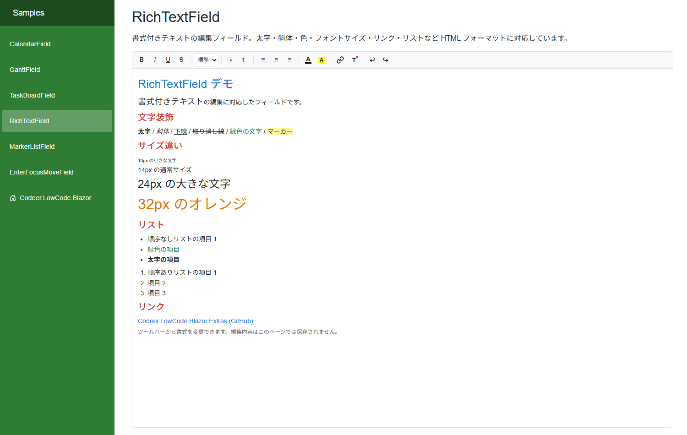

# RichTextField - リッチテキストエディタ

書式付きテキスト (HTML) を編集・保存できる値フィールドです。ツールバーから太字・色・リンクなどの書式を適用できます。



## 機能

- **書式ツールバー**: 太字、斜体、下線、取り消し線
- **見出し設定**: 標準テキスト / H1〜H6 の見出しレベル
- **リスト**: 箇条書きリスト、番号付きリスト
- **テキスト配置**: 左揃え、中央揃え、右揃え
- **文字色 / 背景色**: 16色パレットから選択
- **リンク挿入**: URL指定でハイパーリンクを挿入
- **書式クリア / Undo / Redo**
- **HTML形式で保存**: DBカラムにHTMLテキストとして永続化

## デザイナー設定プロパティ

「デザイナ表示名」は Designer (日本語環境) で表示されるラベルです。

| プロパティ | デザイナ表示名 | 型 | 説明 |
|---|---|---|---|
| DisplayName | 表示名 | string | フィールドの表示名 (`ValueFieldDesignBase` 継承) |
| DbColumn | DBカラム | string | データを保存するDBカラム名 |
| IsRequired | 必須 | bool | true で未入力をバリデーションエラー (`ValueFieldDesignBase` 継承) |
| OnDataChanged | データ変更イベント | string | データ変更時に呼び出すスクリプトイベント (`ValueFieldDesignBase` 継承) |

## 必要なDB構成

HTML文字列を格納するためのテキスト型カラムが必要です。長文を想定する場合は `NVARCHAR(MAX)` や `TEXT` 型を推奨します。

## 表示モード

- **編集モード**: ツールバー付きのエディタを表示。テキストの書式設定が可能
- **閲覧モード**: HTMLをレンダリングして表示。リンクは新しいタブで開く
- **HTML の消毒**: 表示するとき・エディタに入れるとき・貼り付けるときに、ブラウザで HTML を消毒する ([DOMPurify](https://github.com/cure53/DOMPurify))。スクリプトが動くもの (script・イベント属性・javascript: の URL)・フォームの部品・class・位置や重なりを変える style (position・z-index 等) を落とす。文字の書式・色・揃え・表・画像・リンクは残る

## スクリプトAPI

| メンバー | 種別 | 説明 |
|---|---|---|
| Value | プロパティ | HTML文字列値の取得・設定 |

## メンション (仕様・未実装)

> この節は実装前の仕様です (2026-11-12)。合意してから実装します。範囲は「本文に人を埋め込む」まで (段階 1) で、通知とメンションの記録は含みません。

本文の中で `@` を打つと、このページを見られる人の候補が出て、選んだ人を本文に埋め込めます (Slack / Teams のメンションと同じ操作)。「全員」も選べます。

### 設定

| プロパティ | デザイナ表示名 | 型 | 説明 |
|---|---|---|---|
| EnableMention | メンション | bool | true で `@` によるメンションを使えるようにする。既定 false (今のアプリの動きを変えない) |

ユーザーのモジュール (`AppSettings.CurrentUserModuleDesignName`) とそこに置いたログインアカウント契約 (LoginAccountContractField) を使います。RichTextField 側の設定はこれだけです。

### 候補になる人

**このフィールドを見られる人** です。判定の基準は、本体がフィールドの読み取りを許すかどうかの入口検査 (`ModuleDataIO.AuthorizationChecker.CheckFieldUserReadAsync`) と同じで、次をすべて満たすユーザーです。

1. アプリアクセス条件 (`AppSettings.AppAccessConditions`) を満たす
2. このフィールドを置いたモジュールの閲覧条件 (`UserReadCondition`) を満たす
3. このフィールドを対象にした PermissionField の読み取り条件のうち、ユーザーだけで決まるもの (`CurrentUser.〜`) を満たす
4. ログインアカウント契約の有効フラグ (`IsActive`) が偽でない (停止したユーザーは出さない)

行の値で決まる条件 (`DataReadCondition`、行を参照する PermissionField の条件) は見ません。入口検査と同じ割り切りで、そのレコード自体は読めない人が候補に出ることがあります。

自分自身も候補に出ます。

### 全員

候補の先頭に「全員」(英語環境では「everyone」) を出します。打った文字が表記の先頭と一致するとき (何も打っていないときを含む) だけ出します。「全員」は上の候補の条件を満たす人全員を指しますが、段階 1 では本文に「全員」と埋め込むだけで、誰かに何かを送ることはありません。

### 候補の絞り込みと並び

- 打った文字 (`@` の後ろ) を、契約の表示名 (`DisplayName`) とログイン ID (`LoginName`) に部分一致で当てる。表示名の役割が空ならログイン ID だけ
- 表示名の昇順で上位 10 件
- 候補の各行は表示名を出す (ログイン ID は補助として小さく出す)
- 問い合わせは打った文字が止まって 200 ms 後。後から打った文字の結果だけを使う (TagField と同じ)。打つたびの問い合わせなので、ローディング表示で画面を覆わない

### 入力の操作

- **候補が出る**: 行頭か空白の直後に `@` (全角の `＠` も) を打ったとき。メールアドレスのように文字の直後の `@` では出さない
- **IME**: 変換中は判定しない。確定した後 (`compositionend`) に判定するので、日本語入力のまま `＠やまだ` と打っても候補が出る
- **キー操作**: 候補が出ている間は ↑ / ↓ で選択、Enter か Tab で確定、Esc で閉じる。このとき Enter で改行は入らない。空白を打つか、カーソルを `@` の外へ動かすと候補は閉じる (打った文字はそのまま残る)
- **確定**: `@打った文字` を消して、選んだ人を 1 つの部品として入れ、その後ろに空白を 1 つ入れる
- **部品の扱い**: 部品の途中にカーソルは入らない。Backspace / Delete で部品ごと消える。部品に書式 (太字・色など) を付けることはできる
- **貼り付け**: 別の RichTextField からコピーした部品は部品のまま貼り付けられる (Id も残る)

### 保存する形

部品は HTML の中にこの形で入ります。値は今までどおり HTML の文字列で、DB の列も変わりません。

```html
<!-- 人 -->
<span class="mention" data-mention-id="123">@山田 太郎</span>
<!-- 全員 -->
<span class="mention" data-mention-all="">@全員</span>
```

- `data-mention-id` はユーザーのモジュールの Id の値。どの人かは Id で決まる
- `@山田 太郎` は入れた時点の表示名の写し。あとで表示名を変えても本文は変わらない
- 編集中だけ `contenteditable="false"` を付ける (エディタに入れるときに付け、保存する HTML には残さない)

### 閲覧

- 部品は名前を囲んだチップの見た目で出す (`.mention`。CSS で変えられる)
- 部品をクリックしても何もしない (ユーザーの詳細を開くなどは段階 1 には無い)

### HTML の消毒の変更

今の消毒 (`safe-html.js` の `richtext`) は class と `data-` 属性をすべて落とすので、次だけ残すように変えます。

- class の `mention`
- 属性の `data-mention-id` と `data-mention-all` (`span` に付いたものだけ)

ほかの class と `data-` 属性は今までどおり落とします。

### スクリプト

| メンバー | 種別 | 説明 |
|---|---|---|
| MentionedIds | プロパティ (string[]) | 今の値に入っているメンションのユーザー Id (重複を除き、本文の順) |
| MentionsAll | プロパティ (bool) | 今の値に「全員」が入っているか |

どちらも読み取りだけです。値 (`Value`) の HTML から取り出すので、保存済みかどうかに関係なく今の内容を返します。保存のときのスクリプトから自前の通知を作るといった使い方ができます。

### 通信 (候補の問い合わせ)

候補は、ユーザーのモジュールを読めない人 (一般の利用者) にも出す必要があるので、クライアントから直接ユーザーのモジュールを検索せず、サーバーに問い合わせます。

- Extras の共通の API (ExtrasTransport / ExtrasApi) の `Mention.Candidates`。要求 = モジュール名・フィールド名・打った文字。応答 = 候補 (Id と表示名、補助のログイン ID) の並びと、「全員」を出すか
- サーバーは `MentionApi` (Extras.Server)。ホストは ExtrasApiTable に 1 行足す
- 入口で、問い合わせた人がそのフィールドを見られること (`CheckFieldUserReadAsync`)、フィールドが RichTextField で `EnableMention` が true であることを確かめる。通らなければ候補を返さない
- 候補はシステムの権限で読み (問い合わせた人の権限では読まない)、返すのは Id・表示名・ログイン ID だけ。このフィールドを見られる人には、このフィールドを見られるほかの人の名前が見える、ということ
- 監査ログの分類は Other (失敗と拒否だけ残る)。打つたびに問い合わせるため
- デスクトップ (Wpf / WinForms) は `RichTextField.MentionCandidatesCoreAsync` のフックで差し替える (ほかの機能と同じ)

### 設計チェック

| コード | 内容 |
|---|---|
| RichTextFieldDesign:1 | `EnableMention` が true なのに、ユーザーのモジュール (`CurrentUserModuleDesignName`) が無い |
| RichTextFieldDesign:2 | `EnableMention` が true なのに、ユーザーのモジュールにログインアカウント契約が無い |

### 段階 1 でしないこと

- **通知とメンションの記録** (「自分宛てのメンション」の一覧を含む)。段階 2 で、保存のときにサーバーが HTML から Id を取り出して作る
- **本文の Id を信用する処理**。ブラウザから送られた HTML は書き換えられるので、表示名と Id が食い違うことがあり得る。段階 1 のメンションは本文の飾りとして扱い、Id で何かをするのは段階 2 でサーバーが確かめてから
- **表示名の変更への追従**。閲覧のたびに今の名前を引き直すと一覧で行ごとの問い合わせが出るため
- **ユーザー以外 (顧客・部署など) のメンション**
- **行の値で決まる権限での絞り込み** (上の「候補になる人」)

### 決めていないこと

- 候補の判定の作り方。アプリアクセス条件・閲覧条件・PermissionField の条件はユーザーのモジュールに対する条件 (`CurrentUser.〜` か、ユーザーのモジュールの項目) なので、これを 1 つのユーザー検索の条件に組み替えて 1 回で引くつもり。組み替えられない条件 (ユーザーだけでは決まらないもの) は入口検査と同じく見ない。本体に「この条件をこのユーザーで評価する」口があればそちらを使う (実装の前に本体を確認する)

## CSS カスタマイズ

リッチテキストエディタの見た目はCSSクラスで自由にカスタマイズできます。全CSSクラス一覧とカスタマイズ例は **[RichTextField CSS カスタマイズガイド](RichTextField-CSS-Customization.md)** を参照してください。
