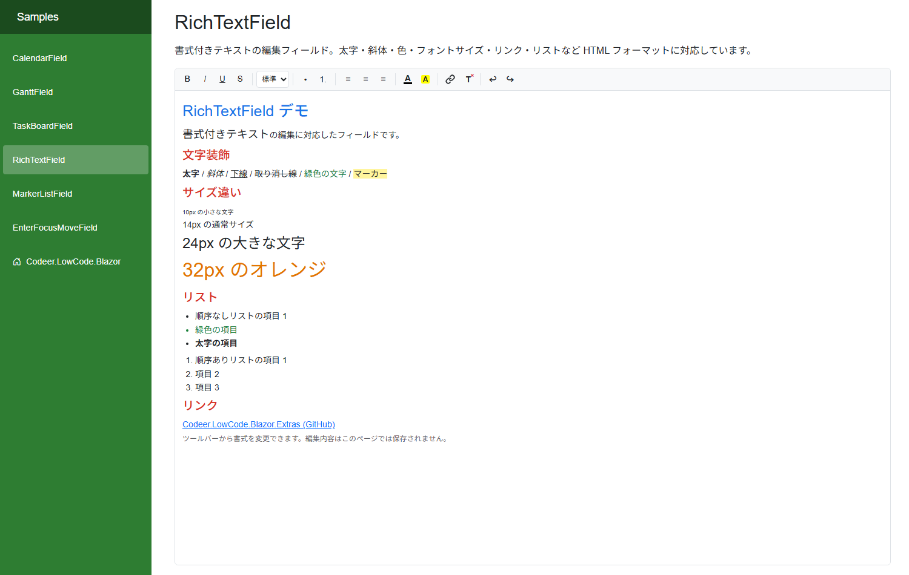

# RichTextField - リッチテキストエディタ

書式付きテキスト (HTML) を編集・保存できる値フィールドです。ツールバーから太字・色・リンクなどの書式を適用できます。



## 機能

- **書式ツールバー**: 太字、斜体、下線、取り消し線
- **見出し設定**: 標準テキスト / H1〜H6 の見出しレベル
- **リスト**: 箇条書きリスト、番号付きリスト
- **テキスト配置**: 左揃え、中央揃え、右揃え
- **文字色 / 背景色**: 16色パレットから選択
- **リンク挿入**: URL指定でハイパーリンクを挿入
- **書式クリア / Undo / Redo**
- **HTML形式で保存**: DBカラムにHTMLテキストとして永続化

## デザイナー設定プロパティ

「デザイナ表示名」は Designer (日本語環境) で表示されるラベルです。

| プロパティ | デザイナ表示名 | 型 | 説明 |
|---|---|---|---|
| DisplayName | 表示名 | string | フィールドの表示名 (`ValueFieldDesignBase` 継承) |
| DbColumn | DBカラム | string | データを保存するDBカラム名 |
| IsRequired | 必須 | bool | true で未入力をバリデーションエラー (`ValueFieldDesignBase` 継承) |
| OnDataChanged | データ変更イベント | string | データ変更時に呼び出すスクリプトイベント (`ValueFieldDesignBase` 継承) |
| EnableMention | メンション | bool | true で `@` によるメンションを使えるようにする。既定 false (下の「メンション」) |
| MentionCandidateCondition | メンションの候補の条件 | ModuleMatchCondition | メンションの候補にする人の条件。空なら絞らない (下の「候補の条件 (段階 2)」) |

## 必要なDB構成

HTML文字列を格納するためのテキスト型カラムが必要です。長文を想定する場合は `NVARCHAR(MAX)` や `TEXT` 型を推奨します。

## 表示モード

- **編集モード**: ツールバー付きのエディタを表示。テキストの書式設定が可能
- **閲覧モード**: HTMLをレンダリングして表示。リンクは新しいタブで開く
- **HTML の消毒**: 表示するとき・エディタに入れるとき・貼り付けるときに、ブラウザで HTML を消毒する ([DOMPurify](https://github.com/cure53/DOMPurify))。スクリプトが動くもの (script・イベント属性・javascript: の URL)・フォームの部品・class・位置や重なりを変える style (position・z-index 等) を落とす。文字の書式・色・揃え・表・画像・リンクは残る

## スクリプトAPI

| メンバー | 種別 | 説明 |
|---|---|---|
| Value | プロパティ | HTML文字列値の取得・設定 |
| MentionedIds | プロパティ (string[]) | 今の値に入っているメンションのユーザー Id (読み取りのみ。下の「メンション」) |
| MentionsAll | プロパティ (bool) | 今の値に「全員」のメンションが入っているか (読み取りのみ) |

## メンション

本文の中で `@` を打つと、このフィールドを見られる人の候補が出て、選んだ人を本文に埋め込めます (Slack / Teams のメンションと同じ操作)。「全員」も選べます。範囲は「本文に人を埋め込む」までで、通知とメンションの記録はありません。

| 段階 | 内容 | 状態 |
|---|---|---|
| 段階 1 | 本文に人を埋め込む。候補はアプリを使える人 | 実装済み |
| 段階 2 | 設計者が書く候補の条件 (同じ部署の人だけ、など。下の「候補になる人」の 3) | 実装済み |
| 段階 3 | 候補を「このフィールドを見られる人」に絞る (「候補になる人」の 4)。判定は本体の `CanReadFieldByUser` | 本体は実装済み (2026-11-20)・Extras は未実装 |
| 段階 4 | 通知とメンションの記録 | 未着手 |

段階 2 と 3 は別々に入れられます (どちらも候補を絞るだけで、要求と応答の形・画面は変えない)。両方入れると、候補は「設計者の条件を満たし、かつこのフィールドを見られる人」(2 と 3 の共通部分) になります。

### 設定

| プロパティ | デザイナ表示名 | 型 | 説明 |
|---|---|---|---|
| EnableMention | メンション | bool | true で `@` によるメンションを使えるようにする。既定 false (今のアプリの動きを変えない) |
| MentionCandidateCondition | メンションの候補の条件 | ModuleMatchCondition | 候補にする人の条件。対象はユーザーのモジュール。空なら絞らない (段階 1 と同じ) |

ユーザーのモジュール (`AppSettings.CurrentUserModuleDesignName`) とそこに置いたログインアカウント契約 (LoginAccountContractField) を使います。ホストには候補の API (`MentionApi`) が要ります (下の「通信」)。

### 候補になる人

ユーザーのモジュールの行のうち、次をすべて満たすものです。

1. アプリアクセス条件 (`AppSettings.AppAccessConditions`) を満たす (条件が空なら全員が満たす)。本体はこの条件をユーザーの行に当てて判定するので、サーバーは同じ条件でユーザーのモジュールを検索して 1 回で引く。条件のモジュールがユーザーのモジュール以外のとき・`CurrentUser.〜` の変数を使っているときは、本体の判定で誰もアプリに入れないので、候補も出さない (サーバーのログに警告)
2. ログインアカウント契約の有効フラグ (`IsActive`) が真 (ログインと同じ読み方で、空 (NULL) は停止扱い。役割が空なら判定しない)
3. 設計者が書いた候補の条件 (`MentionCandidateCondition`) を満たす (下の「候補の条件 (段階 2)」)
4. **(段階 3)** その人がこのフィールドを見られる (下の「このフィールドを見られる人 (段階 3)」)

3 は「誰に向けて書くか」の絞り込みで、4 は権限です。3 だけでは、条件の外の人がこのフィールドを見られなくなるわけではありません。読ませたくない人がいる場合は、権限 (閲覧条件・PermissionField) で絞ってください。4 がそれを候補にも反映します。

自分自身も候補に出ます。ただし 3 の条件を自分が満たさないときは出ません (4 は、入口検査を通った人なので満たす)。

#### 候補の条件 (段階 2)

- 型は本体の権限の条件と同じ `ModuleMatchCondition`。デザイナは本体の条件の編集画面をそのまま使う。条件のモジュールはユーザーのモジュール (空も可)
- 左辺はユーザーのモジュールの項目 (候補になる人の値)。右辺には値のほか、`CurrentUser.〜` (`@` を打っている人の値) を書ける。例: 「部署 = `CurrentUser.部署`」で、自分と同じ部署の人だけ
- 書けない形: 左辺の `CurrentUser.〜` (候補になる人の項目ではない) と、右辺の `CurrentUser.〜` 以外の変数 (候補になる人の項目どうしの比較。本体の検索は同じ行の項目どうしを比べられず、例外になる。2026-11-18 にテストで確認)。設計チェックが指摘する (`RichTextFieldDesign:4`)
- サーバーは、この条件を 1 (アプリアクセス条件) と打った文字の条件に AND で足して、ユーザーのモジュールを 1 回で検索する (絞り込みは DB がするので、条件が狭くても候補の数の上限に引っかからない)
- `CurrentUser.〜` の値は本体が埋める。候補はシステムの権限で検索している (`ModuleDataIOSystemAccess.GetListAsync`) が、本体はこの検索でも条件の `CurrentUser.〜` を問い合わせた人の行の値で埋める (本体のソースで確認 2026-11-18: `ModuleDataIO.GetListWithoutAuthorizationAsync` が `AssignCurrentUserValue` を呼ぶ。公開メソッドの説明にも明記されている)。Extras では条件を解釈しない
- 問い合わせた人の項目が空のとき、`CurrentUser.〜` は空の値になる。「部署 = `CurrentUser.部署`」なら、部署が空の人には部署が空の人だけが候補に出る (2026-11-18 にテストで確認。条件が外れて全員が出ることはない)
- 条件は設計にだけあり、画面からは送らない (変えられない)
- 設計チェックが指摘する形の条件 (別のモジュールを対象にした条件・上の「書けない形」) が実行時に来たら、候補を出さない (サーバーのログに警告)。条件を外して全員を出すことはしない
- **いま編集しているレコードの値は使えない** (例: 「このプロジェクトのメンバーだけ」)。使うには、画面から条件が参照する項目の値を送り、サーバーがそれを条件に入れる必要がある。その入れる処理 (本体の `AssignValue`) は本体の internal で、LinkField は本体の中から呼んでいる。必要になったら、本体に公開の口を足してから別の段階で入れる (送られた値は書き換えられるので、そのときも 3 は絞り込みで、権限は 4 で守る)

#### このフィールドを見られる人 (段階 3)

候補を問い合わせた人に行っている入口検査 (下の「通信」の `CheckFieldUserReadAsync`) と同じ判定を、候補の 1 人ずつに行います。判定の中身は次のとおりです (本体の判定なので、本体が変われば候補もそれに従う)。

- アプリアクセス条件
- モジュールの閲覧条件 (`UserReadCondition`)
- このフィールドを対象にした PermissionField の読み取り条件のうち、ユーザーだけで決まる部分 (`CurrentUser.〜`)。行の値で決まる部分は見ない (行の値しだいで見られる人は候補に出る)
- データの閲覧条件 (`DataReadCondition`) は見ない (行を読まない判定のため)

つまり 4 は「このページでこのフィールドを開ける人」です。ただし行ごとの条件は見ないので、候補に出た人がいま書いているレコードを読めるとは限りません。段階 3 も本文に入れるだけで誰にも何も送らないので、ここで割り切ります。レコードごとに確かめるのは、通知を作る段階 4 です (下の「まだしないこと」)。

**本体に足したもの** (権限の判定なので本体に置く。2026-11-20 に本体の `feature/mention` に実装済み。Extras が参照できるのは、これを含む版の NuGet が出てから):

- `AuthorizationChecker.CanReadFieldByUser(ModuleData? user, string moduleName, string fieldName)` (bool・同期)。「指定したユーザーの行で、このフィールドを読めるか」を返す。判定は `CheckFieldUserReadAsync` と同じ規則 (アプリアクセス条件・閲覧条件はユーザーの行に当てる `IsMatch`、PermissionField は `GetUserFieldPermissions`)。渡された行だけで決まる計算で、DB は読まない
- `CheckFieldUserReadAsync` も同じ判定 (`GetFieldUserReadDeniedReason`) を今のユーザーの行で通る (2 つの判定が食い違わないよう、規則は 1 か所)
- `user` が null (行の無い人) は、ユーザーのモジュールがあれば読めない
- モジュールが無ければ例外。フィールドが無いときは、読めない人には false、読める人には例外 (拒否がフィールドの有無より先)。Extras は入口でフィールドを確かめてから呼ぶので、候補の判定で例外にはならない
- 本体のテスト (`PermissionEnforcementDbTest`): 下の確認表の各行と JSON のノードのフィールドで、その人として呼んだ `CheckFieldUserReadAsync` と同じ結果になること (別の人がログインしている状態で行を渡しても変わらない)

**Extras の判定の仕方**:

- 1〜3 で引いた行を表示名の順に読み、1 人ずつ本体の `CanReadFieldByUser` で判定して、外れた人を飛ばし、通った人で 10 件そろえる。判定は手元の計算だけなので、人数の上限は設けない (読む行の上限は段階 1 と同じ 50 行 × 20 ページ)
- 判定には条件が参照するユーザーの項目が要るので、判定するときはユーザーの行を全項目読む (段階 1 は Id・表示名・ログイン ID・有効フラグだけ)。本体が現在のユーザーを読むときも項目を絞っていない。Extras が読んだ行で同じ結果になることは、Extras のテストで確かめる
- 閲覧条件もアプリアクセス条件と同じくユーザーの行に当てる条件なので、1 と同じ組み替えで検索にも足す (読む行を減らすため。最後の判定は本体のメソッドに任せるので、組み替えられない形なら足さないだけ。閲覧条件が狭いと、表示名順の先頭に該当者がおらず読む行の上限に達して候補が空になるのを防ぐ)
- 判定は飛ばさず、候補の全員に行う。手元の計算だけなので、「条件が無ければ判定しない」という近道は作らない (近道の条件を Extras で持つと、本体の規則と食い違う)
- **実装のときに気を付ける点** (2026-11-18 に本体 1.3.68 のソースで確認。旧方式で一度実装したときに見つけた):
  - 項目どうしの比較 (`FieldVariableMatchCondition` で右辺が `CurrentUser.〜` でないもの) を含むアプリアクセス条件・閲覧条件は、本体のメモリ上の判定 (`IsMatch`) が常に偽にする。検索 (SQL) にそのまま足すと結果が食い違うので、この形は検索に足さない (段階 1 の検索は今この形もそのまま足している。段階 3 で合わせて直す)
  - JSON のノードに置いたフィールドの可否は、親の JsonField に従う。これは `CanReadFieldByUser` の中で判定されるので、Extras で親をたどる必要はない (本体のテストで確認済み)
- 判定の結果は覚えない (問い合わせのたびに判定する。権限の変更がすぐ候補に効く)

2026-11-17 に、本体 1.3.67 の入口検査をその人として呼んで確かめた結果 (ユーザー 1 = Rank 10、5 = Rank 1。本体の `CanReadFieldByUser` はこれと同じ結果を返す。本体のテストで確認済み):

| 条件 | 1 | 5 |
|---|---|---|
| なし | 通る | 通る |
| 閲覧条件 (ユーザーのモジュール) Rank >= 5 | 通る | 拒否 |
| PermissionField の読み取り条件 `CurrentUser.Rank` >= 5 | 通る | 拒否 |
| PermissionField の読み取り条件 (行の値) Title = 'x' | 通る | 通る |
| PermissionField の読み取り条件 `CurrentUser.Rank` >= 5 AND (行の値) | 通る | 拒否 |
| PermissionField の読み取り条件 `CurrentUser.Rank` >= 5 OR (行の値) | 通る | 通る |
| アプリアクセス条件 Rank >= 5 | 通る | 拒否 |
| 存在しないユーザー | 拒否 | 拒否 |

閲覧条件を「このモジュールで `CurrentUser.〜`」や行の値で書いたときは、本体の入口検査で全員が拒否される。このときは問い合わせた人自身が入口で拒否されるので、候補の問い合わせ自体が通らない (段階 1 と同じ)。

### 全員

候補の先頭に「全員」(英語環境では「everyone」) を出します。打った文字が表記の先頭と一致するとき (何も打っていないときを含む) だけ出します。「全員」は上の「候補になる人」の条件 (その段階で入っているもの) をすべて満たす人全員を指しますが、本文に「全員」と埋め込むだけで、誰かに何かを送ることはありません。

### 候補の絞り込みと並び

- 打った文字 (`@` の後ろ) を、契約の表示名 (`DisplayName`) とログイン ID (`LoginName`) に部分一致で当てる。表示名の役割が空ならログイン ID だけ
- 表示名の昇順で上位 10 件 (並べるのは表示名の列。表示名が空の人はログイン ID で出るが、並びでは先頭に来る)。段階 3 では、この順に判定して外れた人を飛ばし、通った人で 10 件そろえる
- 打った文字が 50 文字を超えたら候補は出さない (画面は問い合わせず、サーバーも読まない)
- 候補の各行は表示名を出す (ログイン ID は補助として小さく出す)
- 候補は画面に固定の位置 (`@` の下) に出す。編集欄の枠の下端で切れない
- 問い合わせは打った文字が止まって 200 ms 後。後から打った文字の結果だけを使う (TagField と同じ)。打つたびの問い合わせなので、ローディング表示で画面を覆わない

### 入力の操作

- **候補が出る**: 行頭か空白の直後に `@` (全角の `＠` も) を打ったとき。メールアドレスのように文字の直後の `@` では出さない
- **IME**: 変換中は判定しない。確定した後 (`compositionend`) に判定するので、日本語入力のまま `＠やまだ` と打っても候補が出る
- **キー操作**: 候補が出ている間は ↑ / ↓ で選択、Enter か Tab で確定、Esc で閉じる。このとき Enter で改行は入らない。空白を打つか、カーソルを `@` の外へ動かすと候補は閉じる (打った文字はそのまま残る)
- **確定**: `@打った文字` を消して、選んだ人を 1 つの部品として入れ、その後ろに空白を 1 つ入れる
- **部品の扱い**: 部品の途中にカーソルは入らない。Backspace / Delete で部品ごと消える。部品に書式 (太字・色など) を付けることはできる
- **貼り付け**: 別の RichTextField からコピーした部品は部品のまま貼り付けられる (Id も残る)

### 保存する形

部品は HTML の中にこの形で入ります。値は今までどおり HTML の文字列で、DB の列も変わりません。

```html
<!-- 人 -->
<span class="mention" data-mention-id="123">@山田 太郎</span>
<!-- 全員 -->
<span class="mention" data-mention-all="">@全員</span>
```

- `data-mention-id` はユーザーのモジュールの Id の値。どの人かは Id で決まる
- `@山田 太郎` は入れた時点の表示名の写し。あとで表示名を変えても本文は変わらない
- 編集中だけ `contenteditable="false"` を付ける (エディタに入れるときに付け、保存する HTML には残さない)

### 閲覧

- 部品は名前を囲んだチップの見た目で出す (`.mention`。CSS で変えられる)
- 部品をクリックしても何もしない (ユーザーの詳細を開くなどは無い)

### HTML の消毒

消毒 (`safe-html.js` の `richtext`) は class と `data-` 属性を落としますが、メンションの部品の次だけは残します。

- class の `mention` (`data-mention-id` か `data-mention-all` の付いた `span` だけ。リンクなど他の要素に付けた `mention` は落とす)
- 属性の `data-mention-id` と `data-mention-all` (`span` に付いたものだけ)

ほかの class と `data-` 属性は今までどおり落とします。Markdown と AI チャットの表示ではメンションの属性も落とします。

### スクリプト

| メンバー | 種別 | 説明 |
|---|---|---|
| MentionedIds | プロパティ (string[]) | 今の値に入っているメンションのユーザー Id (重複を除き、本文の順) |
| MentionsAll | プロパティ (bool) | 今の値に「全員」が入っているか |

どちらも読み取りだけです。値 (`Value`) の HTML から取り出すので、保存済みかどうかに関係なく今の内容を返します。保存のときのスクリプトから自前の通知を作るといった使い方ができます (Id はブラウザから送られた HTML の中身なので、通知に使うならスクリプト側で実在するユーザーか確かめてください)。

### 通信 (候補の問い合わせ)

候補は、ユーザーのモジュールを読めない人 (一般の利用者) にも出す必要があるので、クライアントから直接ユーザーのモジュールを検索せず、サーバーに問い合わせます。

- Extras の共通の API (ExtrasTransport / ExtrasApi) の `Mention.Candidates`。要求 = モジュール名・フィールド名・打った文字。応答 = 候補 (Id と表示名、補助のログイン ID) の並び。「全員」を出すかは画面側が表記と打った文字で決める
- サーバーは `MentionApi` (Extras.Server `Mention/`)。ホストは ExtrasApiTable の Handlers に `new MentionApi()` を 1 行足す
- 入口で、問い合わせた人がそのフィールドを見られること (`CheckFieldUserReadAsync`)、フィールドが RichTextField で `EnableMention` が true であることを確かめる。通らなければ候補を返さない
- 候補はシステムの権限で読み (問い合わせた人の権限では読まない)、返すのは Id・表示名・ログイン ID だけ。このフィールドを見られる人には、候補になる人全員の名前とログイン ID が見える、ということ
- 候補を決める処理はサーバーの 1 か所 (`MentionCandidateQuery`) にまとめてある。段階 2 の条件 (設計の `MentionCandidateCondition` を `MentionApi` が渡す) もここで足している。段階 3 の判定もここに足す (要求と応答の形・画面は変えない)
- 監査ログの分類は Other (失敗と拒否だけ残る)。打つたびに問い合わせるため
- デスクトップ (Wpf / WinForms) は `RichTextField.MentionCandidatesCoreAsync` のフックで差し替える (ほかの機能と同じ)

### 設計チェック

| コード | 内容 |
|---|---|
| RichTextFieldDesign:1 | `EnableMention` が true なのに、ユーザーのモジュール (`CurrentUserModuleDesignName`) が無い |
| RichTextFieldDesign:2 | `EnableMention` が true なのに、ユーザーのモジュールにログインアカウント契約が無い |
| RichTextFieldDesign:3 | `MentionCandidateCondition` のモジュールがユーザーのモジュールでない (空は可) |
| RichTextFieldDesign:4 | `MentionCandidateCondition` の項目がユーザーのモジュールの項目でない (左辺に無い項目・左辺の `CurrentUser.〜`・右辺の `CurrentUser.〜` に無い項目・右辺の `CurrentUser.〜` 以外の変数) |

`:4` の文言は理由ごとに分けています (ユーザーのモジュールに無い項目 / 左辺に `CurrentUser.〜` は書けない / 候補になる人の項目どうしは比べられない)。

`:3` と `:4` は `EnableMention` が true のときだけ見ます。条件の項目とモジュールの名前の変更 (リファクタ) にも追従します (`ChangeName`。左辺も右辺の `CurrentUser.〜` もユーザーのモジュールの項目として扱う)。

### まだしないこと

- **通知とメンションの記録** (「自分宛てのメンション」の一覧を含む)。段階 4 で、保存のときにサーバーが HTML から Id を取り出して作る。宛先は段階 2・3 と同じ条件で絞り、さらにそのレコードを読めるか (行ごとの条件) もその人として確かめる
- **本文の Id を信用する処理**。ブラウザから送られた HTML は書き換えられるので、表示名と Id が食い違うことがあり得る。メンションは本文の飾りとして扱い、Id で何かをするのは段階 4 でサーバーが確かめてから
- **表示名の変更への追従**。閲覧のたびに今の名前を引き直すと一覧で行ごとの問い合わせが出るため
- **ユーザー以外 (顧客・部署など) のメンション**
- **編集中のレコードの値を使う候補の条件** (このプロジェクトのメンバーだけ、など)。上の「候補の条件 (段階 2)」の最後の項目
- **入れた後に条件から外れた人の扱い**。段階 2・3 の絞り込みは候補を出すときだけで、本文に入っている部品はそのまま残る

## CSS カスタマイズ

リッチテキストエディタの見た目はCSSクラスで自由にカスタマイズできます。全CSSクラス一覧とカスタマイズ例は **[RichTextField CSS カスタマイズガイド](RichTextField-CSS-Customization.md)** を参照してください。
